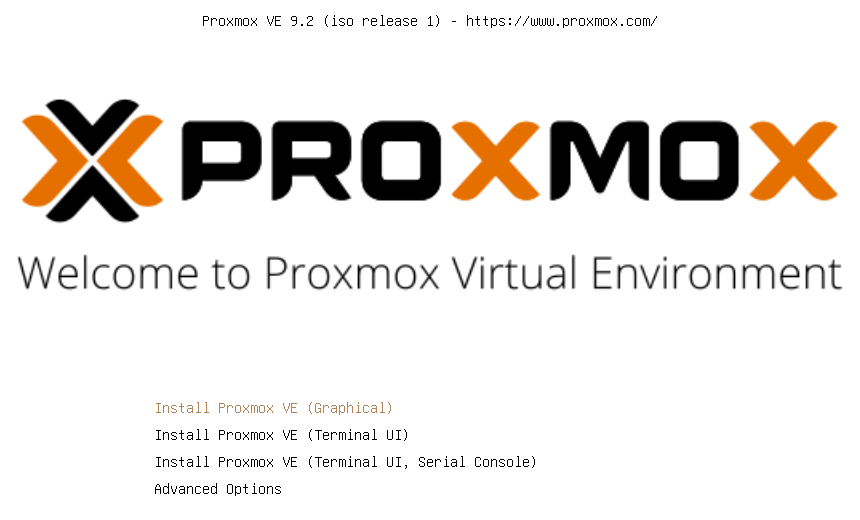
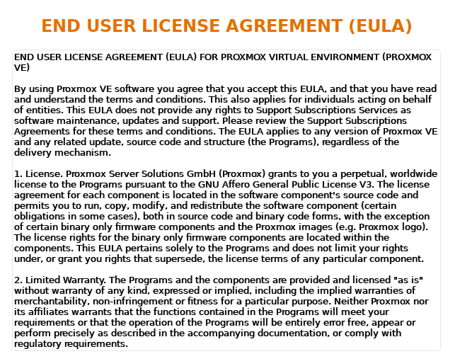
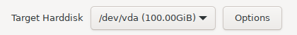
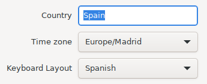
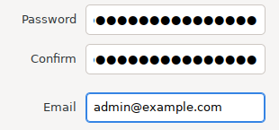
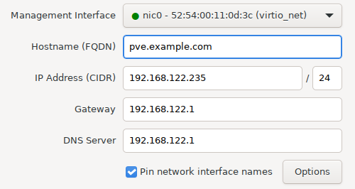
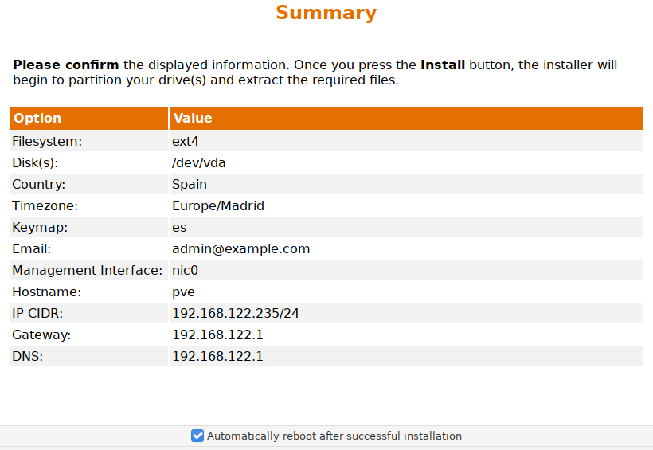

# Instalación de Proxmox VE

Vamos a instalar la versión 9 de Proxmox VE que está basada en la
última versión estable de debian (la versión Trixie, Debian 13). Aunque
podríamos [instalar Proxmox en un sistema Debian 13
Trixie](https://pve.proxmox.com/wiki/Install_Proxmox_VE_on_Debian_13_Trixie)
ya existente, vamos a utilizar un fichero para hacer una instalación
completa del sistema.

Para ello nos vamos a la [página oficial de
descargas](https://www.proxmox.com/en/downloads/proxmox-virtual-environment/iso)
y nos bajamos el fichero ISO de la última versión: **Proxmox VE 9.x ISO Installer**
(en el momento de escribir este curso, la versión 9.2).

Una vez que hemos preparado nuestra máquina donde vamos a hacer la
instalación, comenzamos el proceso:

Comenzamos la instalación eligiendo la opción **Install Proxmox VE (Graphical)**.
Si el instalador gráfico diera problemas con nuestro hardware, podemos
usar la opción **Install Proxmox VE (Terminal UI)**, que realiza la misma
instalación en modo texto.

A continuación aceptamos el acuerdo de licencia (**EULA**) pulsando
sobre **I agree**.

Selecciona el disco donde vamos a realizar la instalación. Por defecto
el disco duro se va a formatear con el sistema de ficheros *ext4*
(con el botón **Options** podríamos escoger otro, por ejemplo *xfs* o *ZFS*):

Configuramos país, la zona horaria y la distribución de teclado:

Configuramos la contraseña del usuario `root` del sistema, con el que
vamos a administrar Proxmox. Además, indicamos una dirección de correo
para que Proxmox nos notifique distintas informaciones. **Tenemos que
indicar una dirección de correo válida**: el instalador no nos dejará
continuar con la dirección que aparece por defecto
(`mail@example.invalid`).

Configuración de red: elegimos la interfaz de red que vamos a
usar. Como hemos comentado la interfaz estará conectada a la misma red
que el host (en mi caso la 192.168.122.0/24) por lo que como vemos la
máquina ha tomado una IP por mi DHCP 192.168.122.235, se indica la
puerta de enlace y el servidor DNS. Esta configuración también se
podría poner de forma estática. También indicamos el nombre FQDN de la
máquina.

Por defecto está marcada la opción **Pin network interface names**,
que fija el nombre de las interfaces de red para que no cambie en
futuras actualizaciones. Por eso la interfaz de red se llama `nic0`.

Nos aparece un resumen de los parámetros de instalación escogidos y
pulsamos sobre **Install** para comenzar la instalación. Si está
marcada la opción **Automatically reboot after successful
installation**, la máquina se reiniciará automáticamente al terminar.
No te olvides de quitar la imagen ISO de la unidad de CD/DVD de la
máquina virtual para que arranque desde el disco duro.

Para profundizar en aspectos más concretos de la instalación de
Proxmox:

* [Installing Proxmox VE](https://pve.proxmox.com/pve-docs/pve-admin-guide.html#chapter_installation)

* [Vídeo: Instalación de Proxmox VE](https://youtu.be/ZsgVP2S8AxY)
