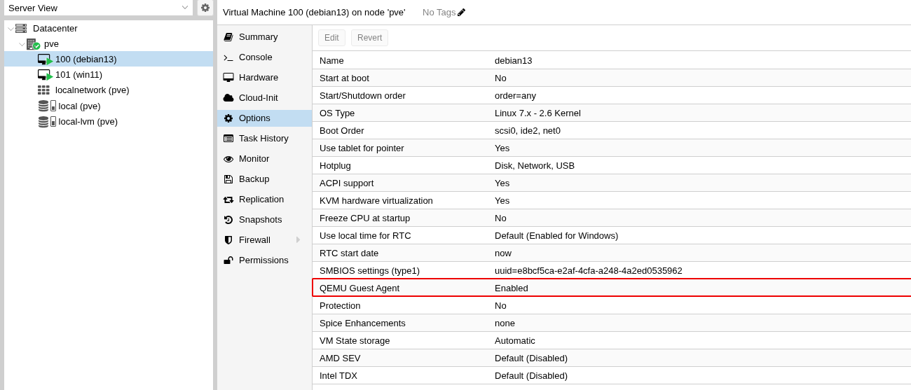
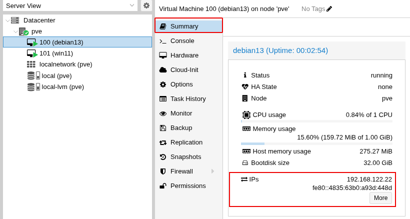

# Instalación de Qemu-guest-agent en las máquinas virtuales

El programa **Qemu-guest-agent** es un demonio que podemos instalar en las máquinas virtuales creadas en Proxmox que nos proporciona que haya una comunicación entre Proxmox y la máquina virtual. Esto nos puede permitir que la gestión del apagado de la máquina virtual sea más óptima y tener información de la máquina, por ejemplo la ip que se ha configurado en sus interfaces de red.

## Configuración de Qemu-guest-agent

Para hacer uso de este programa debemos activarlo en la configuración de la máquina. Podemos hacerlo al crear la máquina, marcando la opción **Qemu Agent** en la pestaña *System* del asistente, o posteriormente en el apartado **Options** de la máquina (opción *QEMU Guest Agent*):

## Instalación de Qemu-guest-agent

Normalmente las máquinas Linux que creamos en Proxmox detectan que se están ejecutando en este entorno y durante la instalación se instala este servicio (por ejemplo, en las máquinas Debian 13 se realiza la instalación automáticamente). Si no se realiza la instalación de forma automática podemos instalar el paquete. Por ejemplo, en Debian/Ubuntu:

    apt install qemu-guest-agent

En el sistema operativo Windows, si hemos ejecutado el programa `virtio-win-guest-tools.exe` del CDROM de los drivers VirtIO, como vimos en el apartado anterior, el programa **Qemu-guest-agent** ya está instalado junto al resto de controladores.

Si no lo hemos hecho, el instalador del agente se encuentra en el directorio `guest-agent` del CDROM (`qemu-ga-x86_64.msi` para 64 bits).

## Prueba de funcionamiento

Podemos obtener información de la IP que se asignado a la máquina:

Para más información: [Qemu-guest-agent](https://pve.proxmox.com/wiki/Qemu-guest-agent)

* [Vídeo: Instalación de Qemu-guest-agent en las máquinas virtuales](https://youtu.be/a6J7wPTiyPw)
