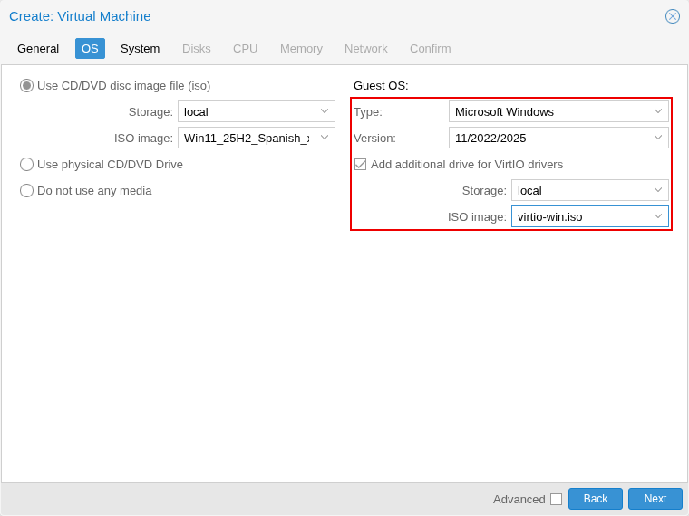
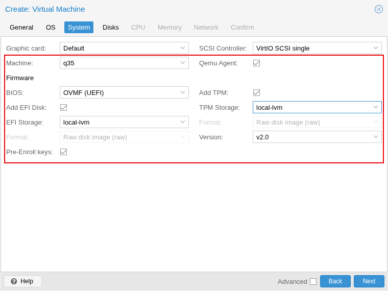
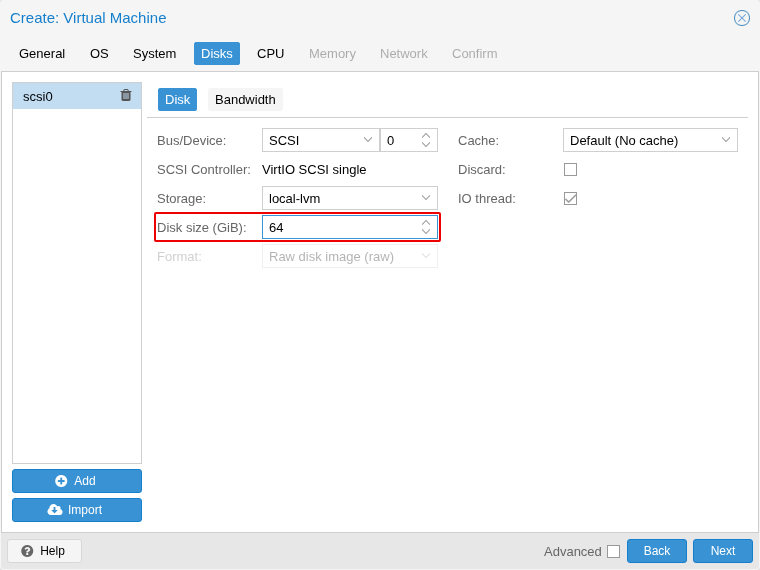
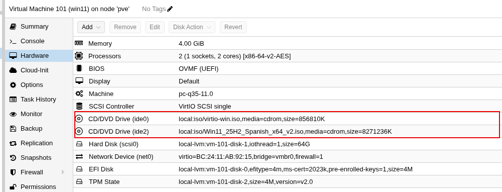
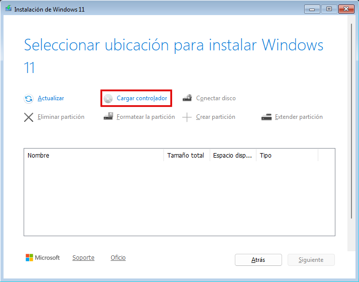
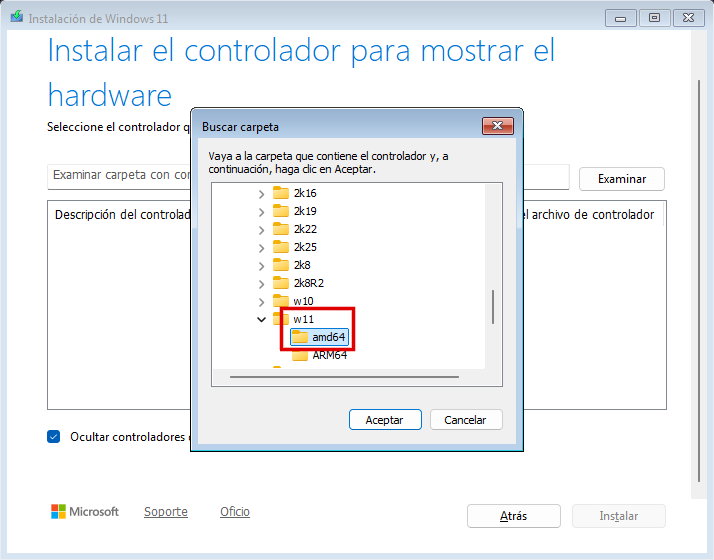
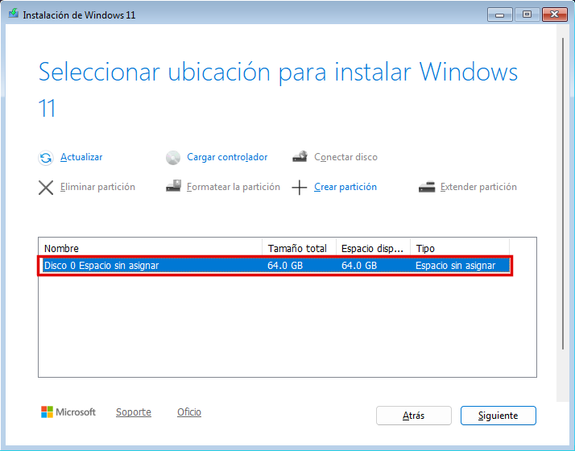
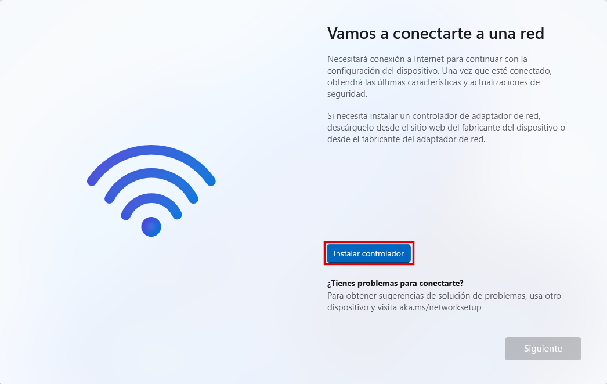
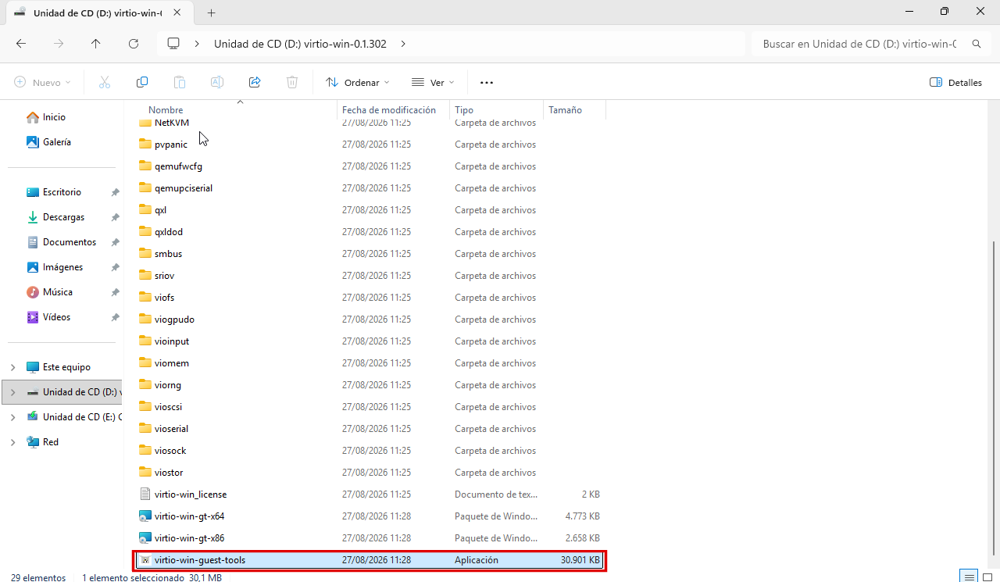
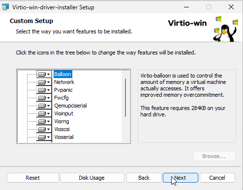

# Creación de máquinas virtuales Windows

En un apartado anterior hemos visto los pasos fundamentales para la
creación de una máquina virtual Linux. Para crear una máquina virtual
con un sistema operativo tipo Windows se siguen los mismos pasos, pero
tenemos que tener en cuenta que Windows no tiene soporte nativo para
dispositivos VirtIO. Por lo tanto, a la hora de crear una máquina
virtual Windows tendremos que añadir los controladores de dispositivos
(*drivers*) necesarios para que Windows identifique los dispositivos
VirtIO que definamos en la máquina virtual.

En este caso, el proyecto Fedora proporciona controladores de
dispositivos de software libre para VirtIO en Windows.

En este apartado vamos a instalar **Windows 11**. Hay que tener en
cuenta sus requisitos: arranque UEFI con *Secure Boot*, un chip TPM
2.0, al menos 4 GiB de RAM y 64 GB de disco. Proxmox VE nos
proporciona UEFI y TPM virtuales, pero la memoria y el disco son
bastante exigentes para un laboratorio con Proxmox VE anidado.
Puedes descargar la ISO de Windows 11 desde la [página de descargas de
Microsoft](https://www.microsoft.com/es-es/software-download/windows11)
o una versión de evaluación desde el [Centro de evaluación de
Microsoft](https://www.microsoft.com/es-es/evalcenter/evaluate-windows-11-enterprise).

## ISO de los controladores de dispositivo VirtIO para Windows

Podemos bajar la última versión de los drivers VirtIO para Windows en
el siguiente
[enlace](https://fedorapeople.org/groups/virt/virtio-win/direct-downloads/stable-virtio/virtio-win.iso)
y subir la ISO a Proxmox VE. Recuerda que también podemos usar la
opción *Download from URL* para que Proxmox VE la descargue
directamente.

## Creamos la nueva máquina virtual Windows

En la pestaña **OS** elegimos la ISO de Windows 11, como sistema
operativo *Microsoft Windows* y como versión *11/2022/2025*. Además,
marcamos la opción **Add additional drive for VirtIO drivers** y
elegimos la ISO de los drivers VirtIO. De esta forma la máquina tendrá
un segundo CD-ROM con los drivers:

Al elegir esta versión de Windows, en la pestaña **System** se
configuran automáticamente las opciones que necesita Windows 11:
máquina *q35*, BIOS *OVMF (UEFI)* con un disco EFI y un chip TPM
(*Add TPM*, versión *v2.0*). Tenemos que elegir dónde se guardan el
disco EFI y el TPM (*EFI Storage* y *TPM Storage*): escogemos
*local-lvm*. El controlador de discos es *VirtIO SCSI single* y
marcamos también la opción **Qemu Agent**:

En la pestaña **Disks** aumentamos el tamaño del disco a 64 GiB, que
es el mínimo que pide Windows 11. En las pestañas **CPU** y **Memory**
configuramos recursos suficientes (por defecto se asignan 4096 MiB de
RAM para Windows 11).

Al terminar el asistente, en el apartado **Hardware** de la máquina
vemos los dos CD-ROM: `ide2` con la ISO de Windows e `ide0` con los
drivers VirtIO. El orden de arranque se configura automáticamente
para que la máquina arranque primero desde el disco duro y después
desde el CD-ROM de Windows, por lo que no tenemos que modificarlo.

## Comenzamos la instalación

Iniciamos la máquina y accedemos a la consola. Como arranca con UEFI,
tenemos que pulsar una tecla cuando aparezca el mensaje *Press any key
to boot from CD or DVD*. Comenzamos la instalación hasta que llegamos
a la pantalla donde tenemos que escoger el disco duro donde vamos a
realizar la instalación.

Como vemos no se puede detectar el disco duro, ya que Windows no puede
reconocer inicialmente el controlador VirtIO. Vamos a cargar los
controladores de dispositivo VirtIO que necesitamos del CDROM que
hemos montado:

Elegimos la opción *Cargar controlador*, le damos a *Examinar* y
elegimos del CDROM donde tenemos los drivers VirtIO la carpeta
`vioscsi\w11\amd64`:

Se encuentra el controlador *Red Hat VirtIO SCSI pass-through
controller*, lo seleccionamos y pulsamos *Instalar*. Ya podemos
continuar con la instalación de Windows porque ya detecta el disco
duro:

## Configuración inicial de Windows y red

También hemos elegido VirtIO para la interfaz de red, pero Windows
todavía no tiene el controlador de la tarjeta de red. Por eso, al
terminar la instalación, en la configuración inicial de Windows
aparece la pantalla *Vamos a conectarte a una red* sin ninguna red
disponible:

Tenemos dos opciones:

* Pulsar *Instalar controlador* y elegir la carpeta
  `NetKVM\w11\amd64` del CDROM de los drivers VirtIO. Así Windows
  tendrá conexión a internet. Ten en cuenta que, en las ediciones Home
  y Pro, Windows nos pedirá iniciar sesión con una cuenta de
  Microsoft.
* Si preferimos crear una cuenta local, pulsamos **Mayús+F10** para
  abrir una consola y ejecutamos `start ms-cxh:localonly`. Aparecerá
  la ventana *Crear un usuario para este equipo*, donde indicamos el
  nombre de usuario, la contraseña y las preguntas de seguridad. En
  este caso instalaremos el controlador de red más tarde.

## Instalación de los controladores VirtIO

Una vez instalado Windows, instalamos todos los controladores VirtIO
que faltan (red, memoria, consola…) de una sola vez. En el CDROM de
los drivers VirtIO ejecutamos el programa
**`virtio-win-guest-tools.exe`**:

Windows nos avisará de que es una aplicación de un *editor
desconocido*; aceptamos para continuar. El asistente instala los
controladores (en la pantalla *Custom Setup* aparecen todos
seleccionados) y además el programa **Qemu-guest-agent**, que
estudiaremos en el siguiente apartado:

Al terminar, la máquina ya tiene conexión de red.

Para más información: [Windows VirtIO Drivers](https://pve.proxmox.com/wiki/Windows_VirtIO_Drivers) y [Windows 11 guest best practices](https://pve.proxmox.com/wiki/Windows_11_guest_best_practices).

* [Vídeo: Creación de máquinas virtuales Windows](https://youtu.be/N_2n2x4lo2U)
