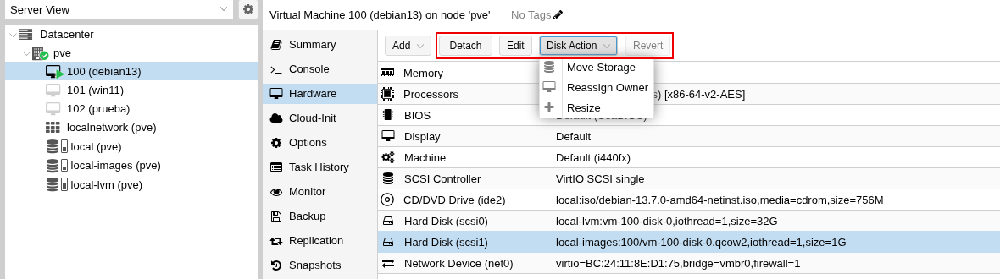
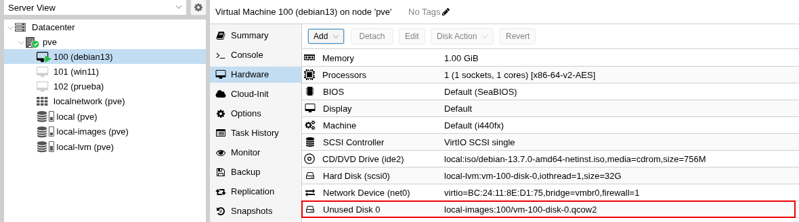
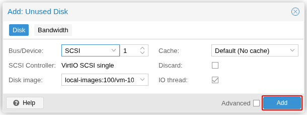
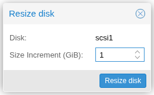
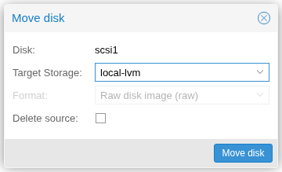
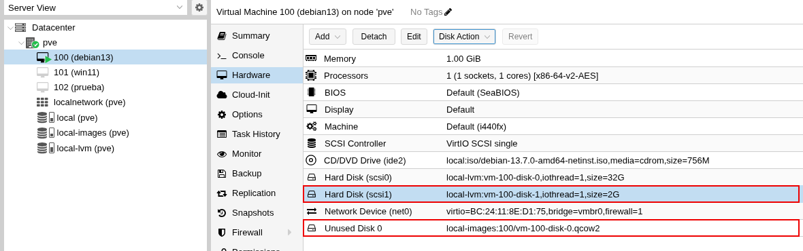

# Gestión de los discos de una máquina virtual

Si elegimos un disco en el apartado *Hardware* de una máquina virtual, observamos que tenemos varias operaciones que podemos realizar sobre él. Algunas están agrupadas en el menú **Disk Action**:



Veamos estas operaciones:

## Edit

Nos permite cambiar algunos parámetros del disco.

## Detach

Nos permite desconectar el disco de la máquina. El fichero de imagen o el volumen lógico no se borra, sino que aparece como disco no usado:



Un disco no usado    lo podemos borrar (opción *Remove*), o lo podemos editar (opción *Edit*). Si lo editamos y le damos a la opción *Add* lo volveremos conectar a la máquina:



## Disk Action → Resize

Podemos aumentar el tamaño de un disco con la opción *Resize* del menú *Disk Action*. Indicamos cuántos GiB queremos añadir:



Recuerda que el aumento de tamaño del disco es independiente del aumento del sistema de ficheros, por lo tanto, si accedemos a la máquina, podemos comprobar que el disco ahora es de 2Gb:

```bash
root@debian:~# lsblk
NAME   MAJ:MIN RM  SIZE RO TYPE MOUNTPOINTS
...
sdb      8:16   0    2G  0 disk /mnt
```

Pero que el sistema de archivo sigue siendo de 1Gb:

```bash
root@debian:~# df -h
S.ficheros     Tamaño Usados  Disp Uso% Montado en
...
/dev/sdb         974M   280K  906M   1% /mnt
```

Como lo habíamos formateado con ext4, tenemos que ejecutar las siguientes instrucciones con el disco desmontado:

```bash
root@debian:~# umount /mnt 
root@debian:~# e2fsck -f /dev/sdb
root@debian:~# resize2fs /dev/sdb
root@debian:~# mount /dev/sdb /mnt
root@debian:~# df -h
S.ficheros     Tamaño Usados  Disp Uso% Montado en
...
/dev/sdb         2,0G   280K  1,9G   1% /mnt
```

Y comprobamos que hemos aumentado el tamaño del sistema de ficheros.

## Disk Action → Move Storage

Con la opción *Move Storage* del menú *Disk Action* podemos copiar el contenido de cualquier disco a otra fuente de almacenamiento disponible. Durante esta copia se puede indicar si se elimina el disco origen, o si se deja como disco no usado.

Nuestro disco adicional estaba guardado en un almacenamiento de tipo *Directory*, lo vamos a mover a una fuente de almacenamiento de tipo *Thin LVM*, por lo tanto, la información guardada en un archivo de imagen qcow2, se va a guardar en un volumen LVM. El disco origen no lo vamos a borrar:



Comprobamos que ahora tenemos un disco guardado en la fuente de almacenamiento **local-lvm** y un disco sin usar en la fuente de almacenamiento **local-images**.



## Disk Action → Reassign Owner

Por último, la opción *Reassign Owner* nos permite pasar el disco a otra máquina virtual del mismo nodo: el disco desaparece de la máquina actual y aparece en la máquina que indiquemos.

* [Vídeo: Gestión de los discos de una máquina virtual](https://youtu.be/lMNAJI4B81U)

