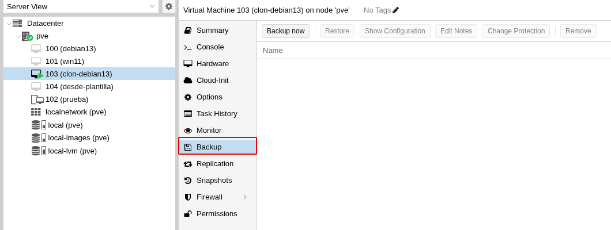
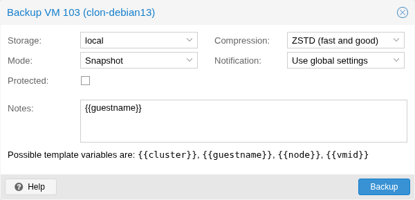
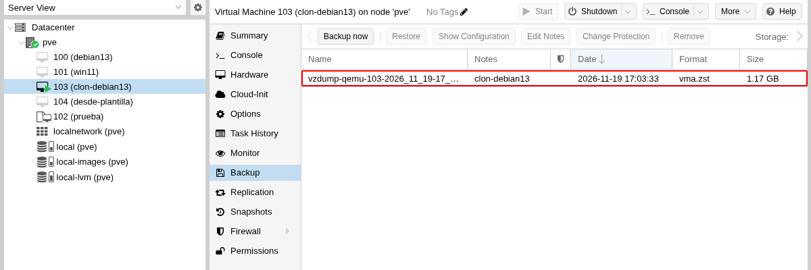
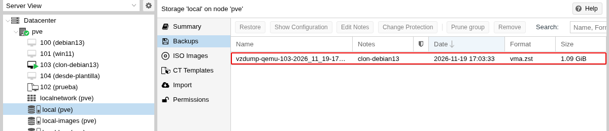
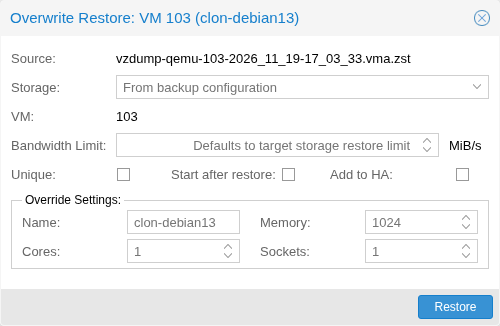
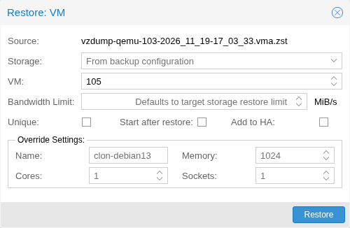

# Copias de seguridad de máquinas virtuales

Las copias de seguridad son otro mecanismo de seguridad que nos permite realizar copias donde se guardará en un archivo comprimido la configuración y el almacenamiento completo de la máquina. Podemos realizar 3 tipos de copias de seguridad:

* **Stop mode**: La máquina se para y se realiza la copia. Garantizamos mayor consistencia de la copia de seguridad, a costa de un breve tiempo de inactividad. Si la máquina estaba corriendo, se parará, se realizará la copia y posteriormente se vuelve a arrancar.
* **Suspend mode**: La máquina se suspende antes de realizar la copia en modo snapshot. Se mantiene por compatibilidad y normalmente no aporta nada frente al modo snapshot.
* **Snapshot mode**: Este modo proporciona el tiempo de inactividad de operación más bajo, a costa de un pequeño riesgo de inconsistencia. En este modo se realiza la copia con la máquina funcionando. Es el modo por defecto.

Podemos ver las copias de seguridad de una máquina en el apartado **Backup**:

Con la opción **Backup now** creamos una nueva copia de seguridad, en la que indicaremos:

* **Storage**: la fuente de almacenamiento donde se va a guardar la copia de seguridad (tiene que admitir el contenido *Backup*, como `local`).
* **Mode**: el modo de copia.
* **Compression**: el algoritmo de compresión (por defecto, *ZSTD*).
* **Notification**: cómo se notifica el resultado de la copia. Por defecto se usa la configuración de notificaciones del Datacenter (**Datacenter → Notifications**). Ya no se indica aquí una dirección de correo.
* **Protected**: si la marcamos, la copia de seguridad queda protegida y no se puede borrar hasta que se quite la protección.
* **Notes**: una nota que acompaña a la copia. Se pueden usar variables como `{{guestname}}` (el nombre de la máquina), que es el valor por defecto.

Si tenemos varios discos conectados a la máquina se realizará la copia de todos. Podemos ver la copia que hemos creado:

Vemos que, en el nombre del fichero de copia de seguridad (por ejemplo, `vzdump-qemu-103-2026_11_19-17_03_33.vma.zst`), se indica que es una máquina virtual (`qemu`), su identificador, la fecha y la hora, el formato de copia de Proxmox (`vma`) y el algoritmo de compresión (`zst`). La copia de seguridad que acabamos de crear también se puede ver desde la opción **Backups** de la fuente de almacenamiento `local`:

A partir de un fichero de copia de seguridad podemos hacer varias operaciones: borrarla (**Remove**), ver la configuración de la máquina guardada (**Show Configuration**), modificar la nota (**Edit Notes**), protegerla (**Change Protection**), ...
Si queremos crear una nueva máquina a partir de dicha copia de seguridad elegiremos la opción **Restore**:

* Si lo hacemos desde el apartado **Backup** de la máquina virtual, la restauración de la copia de seguridad se realizará sobre la misma máquina virtual (**Overwrite Restore**), que se sobrescribirá. La máquina tiene que estar parada.

    

* Si lo hacemos desde el apartado **Backups** de la fuente de almacenamiento **local**, podremos crear una nueva máquina virtual a partir de la copia de seguridad, indicando su ID en el campo **VM**.

    

En las dos formas podremos elegir en qué almacenamiento se crea la máquina (**Storage**; por defecto, el que tenía en la copia), si se arranca al terminar (**Start after restore**), si se generan de nuevo propiedades únicas como la dirección MAC (**Unique**) y, en **Override Settings**, cambiar el nombre, la memoria y el número de núcleos y de sockets.

Las copias de seguridad también se pueden programar para que se realicen de forma periódica desde **Datacenter → Backup**.

---

Para seguir profundizando:

* [Backup and Restore](https://pve.proxmox.com/wiki/Backup_and_Restore)

---

* [Vídeo: Copias de seguridad de máquinas virtuales](https://youtu.be/V-7xGQ72xbs)
