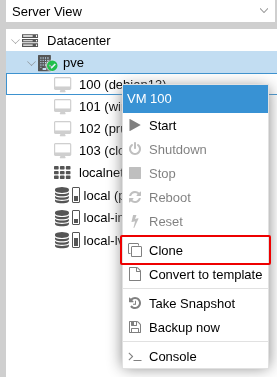
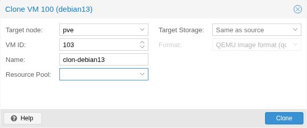
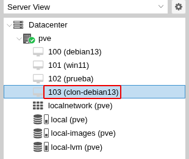

# Clonación de máquinas virtuales

Lo habitual al crear una máquina virtual es hacerlo a partir de una imagen ISO. La clonación y las plantillas nos permiten la creación rápida de máquinas virtuales del mismo tipo.

Cuando usamos la clonación vamos a crear una nueva máquina virtual independiente del origen (**clonación completa**), en el que el almacenamiento es independiente a la primera.

Vamos a partir de que tenemos una máquina ya creada, para crear una exactamente igual a la primera elegimos la opción **Clone** del menú contextual de la máquina (también está en el botón **More**):

En la siguiente pantalla de clonación:

Elegimos el ID, el nombre de la nueva máquina y la fuente de almacenamiento donde se va a producir la clonación (**Target Storage**, por defecto *Same as source*, el mismo que el de la máquina original). El formato del disco (**Format**) solo se puede elegir si la fuente de almacenamiento de destino admite varios, por ejemplo, un directorio (raw o qcow2).

Es preferible clonar la máquina **apagada**. Si está encendida, Proxmox copia el disco en caliente, la operación es más lenta y en `local-lvm` puede llegar a ocupar el tamaño completo del disco en lugar de solo los datos usados. En nuestro laboratorio, la clonación de una máquina Debian 13 apagada con un disco de 32 GiB tarda unos segundos y ocupa poco más de 2 GiB.

Una vez producida la clonación tendremos una nueva máquina virtual igual a la primera:

Proxmox genera una nueva dirección MAC para la tarjeta de red de la máquina clonada, por lo que, si la red se configura por DHCP, recibirá una dirección IP distinta. Sin embargo, el sistema operativo de las dos máquinas es idéntico, por lo que tendremos que modificar alguna configuración de la nueva máquina: por ejemplo, el hostname, la configuración de red si usa una dirección IP estática, ...

* [Vídeo: Clonación de máquinas virtuales](https://youtu.be/evFdEc3ChjE)
