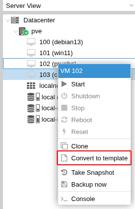
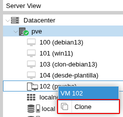
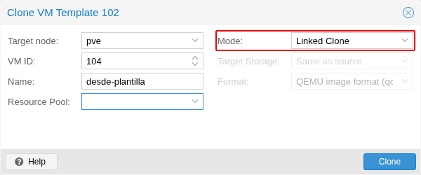
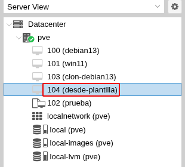
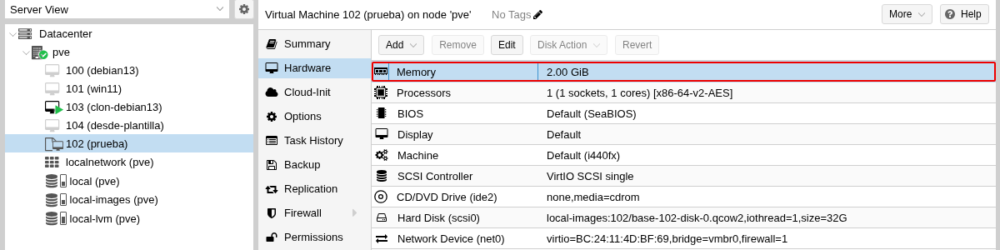

# Convirtiendo máquinas virtuales en plantillas

Otra manera de crear rápidamente nuevas máquinas virtuales es usar una plantilla para su creación. Si partimos de una máquina que ya tenemos configurada, la podemos convertir en una plantilla y a partir de ella crear nuevas máquinas.

Las plantillas son de solo lectura por lo que ya no podremos usar de nuevo la máquina original (no se puede arrancar). Si utilizamos plantillas en lugar de máquinas clonadas, el proceso de obtención de la nueva máquina será mucho más rápido, ya que se podrá utilizar **aprovisionamiento ligero** (a este tipo de clonación se le llama **clonación ligera**) para su creación, es decir, el almacenamiento de la máquina virtual estará vinculada a la plantilla de la que procede, y estaremos ahorrando espacio de almacenamiento.

Es necesario que la máquina virtual que vamos a convertir en una plantilla esté parada. Para convertirla en una plantilla elegiremos la opción **Convert to template** del menú contextual (también está en el botón **More**):

Al convertir la máquina en una plantilla observamos que cambia el icono de identificación y que la única opción que nos permite es clonarla (en un clúster también se puede migrar a otro nodo):

Al elegir la opción de clonación a partir de la plantilla que hemos creado, nos aparece la siguiente ventana, en la que ahora aparece la opción **Mode**:

Donde indicamos el ID y nombre de la nueva máquina y podemos elegir los dos tipos de clonación (por defecto, **Linked Clone**):

* **Clonación completa** (Full Clone): Sería exactamente como el proceso de clonación que hemos estudiado en el apartado anterior. El almacenamiento de la nueva máquina virtual es independiente al de la original. En este caso podremos escoger la fuente de almacenamiento donde se va a crear (**Target Storage**).
* **Clonación ligera** (Linked clone): En este caso estaríamos creando el almacenamiento de la nueva máquina con aprovisionamiento ligero, por lo cual la imagen de la plantilla sería la imagen base de la nueva máquina que tendría un almacenamiento que iría creciendo conforme se fueran produciendo cambios en la máquina. Como consecuencia, si elegimos este tipo de clonación, al crear las nuevas máquinas no ocuparían espacio de almacenamiento, e irían creciendo conforme la máquina fuera haciendo modificaciones.

La clonación ligera nos permite crear nuevas máquinas virtuales de forma muy rápida, ya que no hay que copiar todo el almacenamiento de la máquina original a la nueva. La clonación ligera necesita que la fuente de almacenamiento lo permita: por ejemplo, ficheros qcow2 en un directorio o LVM-thin (`local-lvm`). En nuestro ejemplo, la plantilla tiene su disco en un directorio y el disco de la nueva máquina es un fichero qcow2 que, recién creado, ocupa menos de 5 MiB y usa como imagen base el disco de la plantilla.

Como en el apartado anterior, las dos máquinas son iguales por lo que tendremos que modificar alguna configuración de la nueva máquina: por ejemplo, el hostname, la configuración de red si es necesario, ...

Por último, indicar que podemos cambiar las características hardware de una plantilla (por ejemplo, el uso de RAM) desde su apartado **Hardware**. De esta forma las nuevas máquinas creadas a partir de ella tendrán las mismas características que hemos modificado. Observa que el disco de la plantilla ha pasado a llamarse `base-102-disk-0`:

* [Vídeo: Convirtiendo máquinas virtuales en plantillas](https://youtu.be/vJkuuPzMxGY)

