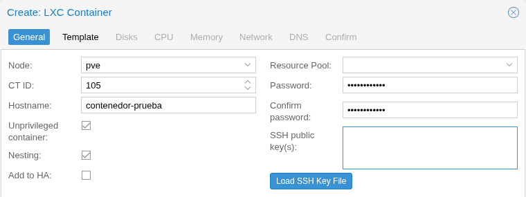
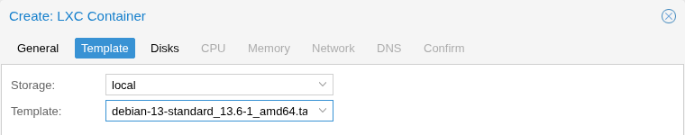
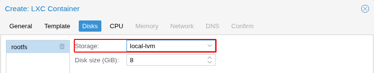
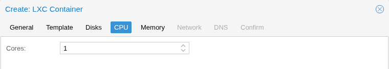
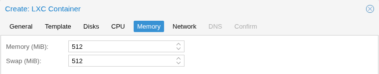
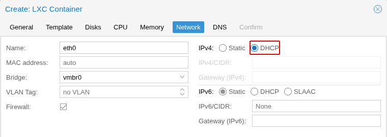
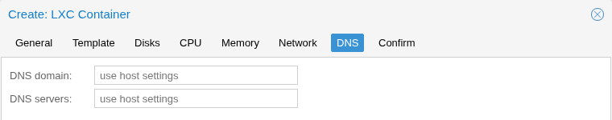
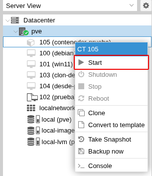
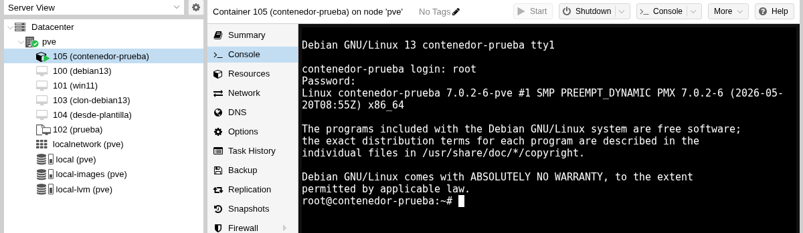

# Creación de contenedores Linux

Después de descargar las plantillas de contenedores con las que vamos a trabajar, estamos en disposición de crear un contenedor LXC. En este apartado vamos a explicar la creación de un contenedor LXC. Sólo indicaremos las opciones más básicas para su creación.

Elegimos la opción de crear un contenedor LXC con el botón **Create CT**:

Y seguimos los siguientes pasos:

## Identificar el contenedor LXC

Indicamos el nodo donde se va a crear el contenedor, su ID y su nombre (**Hostname**). Además, tendremos que indicar la contraseña de acceso para el usuario `root` del contenedor o indicar nuestra clave ssh pública para el acceso al contenedor.

Por defecto, el contenedor se crea **sin privilegios** (**Unprivileged container**): el usuario `root` del contenedor no es el usuario `root` del servidor Proxmox, lo que es más seguro. También está marcada la opción **Nesting**, necesaria para que `systemd` funcione correctamente dentro del contenedor. Dejamos las dos opciones marcadas.

## Elegimos la plantilla 

Elegimos la plantilla desde la que vamos a crear el contenedor entre las que hemos descargado anteriormente. La plantilla se escogerá del medio de almacenamiento *local*.

## Selección del disco

En la pestaña **Disks** seleccionamos la configuración del disco raíz del contenedor que vamos a crear (**rootfs**). Elegimos el medio de almacenamiento para almacenar el disco, por ejemplo, *local-lvm* (en este caso el disco del contenedor se guardará en un volumen lógico). También indicaremos el tamaño del disco (por defecto, 8 GiB). Con el botón **Add** podríamos añadir más volúmenes al contenedor, como veremos en el apartado *Añadir almacenamiento a un contenedor LXC*.

## Selección de la CPU

Seleccionamos el número de cores de vCPU que va a usar el contenedor.

## Configuración de la memoria

Indicamos la cantidad de memoria que tendrá nuestro contenedor y el tamaño de la memoria de intercambio (**Swap**), en MiB no MB (!). Por defecto, 512 MiB de cada una.

## Configuración de red

En un principio nuestro contenedor estará conectado al bridge externo *vmbr0* y la tarjeta de red se llamará *eth0*. Esta configuración se puede cambiar, y podríamos conectar nuestro contenedor a un bridge software definido por nosotros. Además, tendremos que decidir si la configuración de red será automática (DHCP) o manual (**Static**, la opción por defecto), indicando la dirección (con formato IPv4/CIDR) y la puerta de enlace. En nuestro caso elegimos **DHCP**.

## Configuración DNS

En este paso podemos configurar los servidores DNS que va a utilizar el contenedor o dejarlo sin rellenar (*use host settings*), con lo que utilizará los DNS definidos en el servidor Proxmox.

Por último, en la pestaña **Confirm** se muestra un resumen de la configuración. Si marcamos la opción **Start after created**, el contenedor se iniciará al terminar su creación.

## Utilización del contenedor

Una vez que se ha creado el contenedor, podemos iniciarlo:

Y acceder a él por medio de la consola, con el usuario `root` y la contraseña que indicamos al crearlo:

* [Vídeo: Creación de contenedores Linux](https://youtu.be/VkanQG31Cjk)
