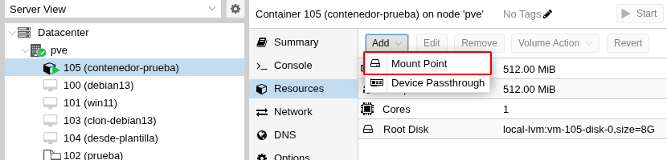
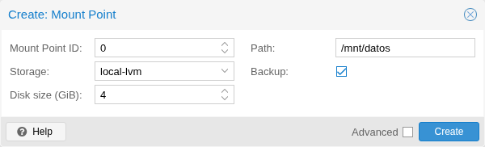
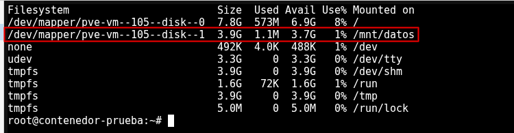

# Añadir almacenamiento a un contenedor LXC

Podemos crear un volumen y montarlo en un directorio de un contenedor LXC.

Para ello escogemos el contenedor y elegimos la opción **Resources** y, en el botón **Add**, añadimos un **Mount Point** (punto de montaje). La otra opción, **Device Passthrough**, permite dar acceso al contenedor a un dispositivo del servidor Proxmox:

A continuación, elegimos la fuente de almacenamiento donde vamos a crear el volumen, su tamaño y el directorio donde se va a montar en el contenedor (**Path**). La opción **Backup** indica si el volumen se incluirá en las copias de seguridad del contenedor. El volumen se puede añadir con el contenedor en ejecución:

El nuevo volumen aparece en **Resources** como **Mount Point (mp0)**. Accedemos a la consola del contenedor y comprobamos que se ha montado el volumen en el directorio indicado:

* [Vídeo: Añadir almacenamiento a un contenedor LXC](https://youtu.be/a9dVQRLZN-s)
