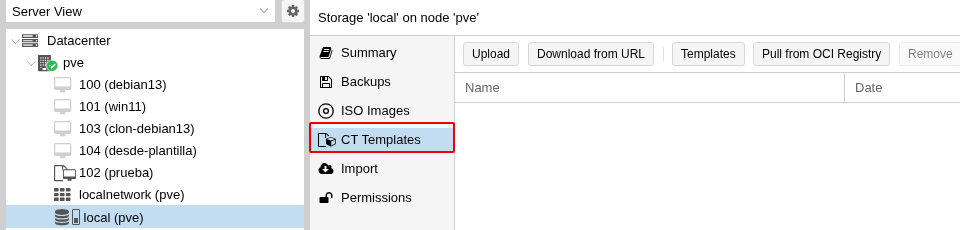
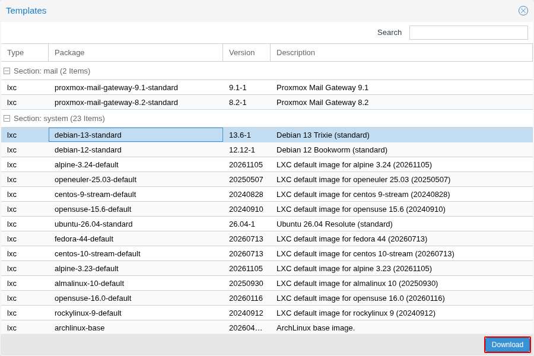
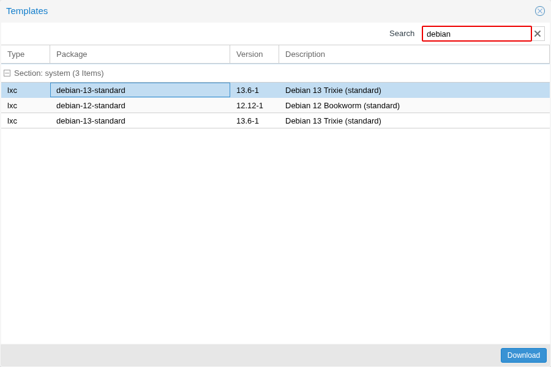
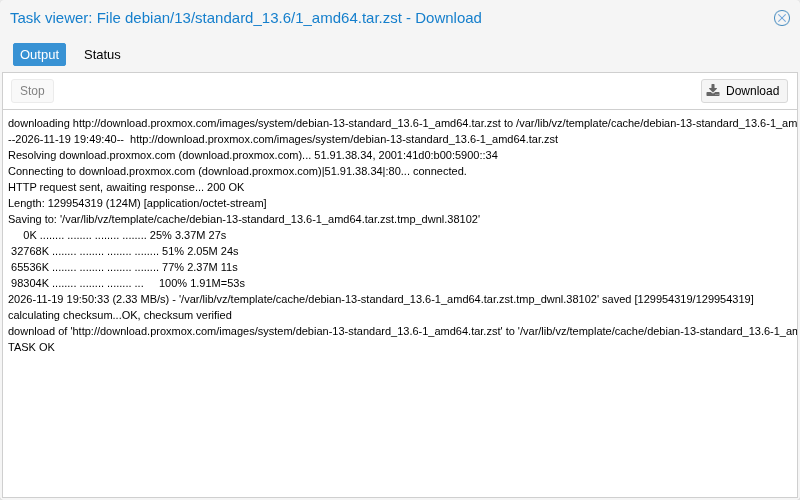
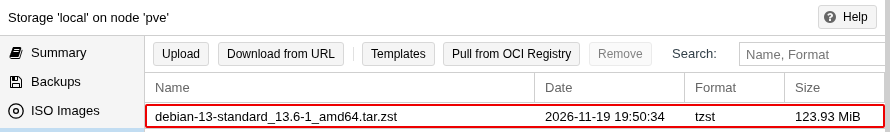

# Gestionando plantillas de contenedores

Los contenedores LXC se crean a partir de una **plantilla**. Una plantilla es el sistema de ficheros que va a utilizar el contenedor. Tendremos plantillas para las distintas distribuciones de Linux.

En Proxmox necesitamos descargar las plantillas que vamos a usar para la creación del contenedor LXC. Al crear un contenedor se clonará la plantilla para que el contenedor tenga su sistema de fichero. Este proceso se hace de manera muy rápida.

## Descargar plantillas en Proxmox

Como indicamos en unidades anteriores, en la fuente de almacenamiento **local** podemos guardar, entre otras cosas, las **plantillas** que usaremos para crear los contenedores.

De esta forma, si accedemos al almacenamiento **local**, y elegimos la opción **CT Templates** accedemos a la ventana que nos permite gestionar las plantillas.

Tenemos cuatro formas de obtener plantillas:

* **Upload**: Podemos subir una plantilla que tengamos en nuestro ordenador local.
* **Download from URL**: Podemos descargar una plantilla usando una URL.
* **Templates**: Proxmox nos ofrece un repositorio con un conjunto de plantillas que podemos descargar.
* **Pull from OCI Registry**: Podemos descargar una imagen OCI (el formato de las imágenes de Docker o Podman) desde un registro de imágenes, como Docker Hub, y usarla como plantilla. Es una novedad de Proxmox VE 9.1 que todavía se considera una *technology preview* (una funcionalidad en pruebas), por lo que no la usaremos en el curso.

En este curso vamos a usar la tercera opción. Podemos elegir, por ejemplo, la plantilla *debian-13-standard* y descargarla con el botón **Download**.

Además, tenemos un buscador que nos permite buscar por nombre. Observa que *debian-13-standard* aparece dos veces: una de ellas es la plantilla para procesadores ARM (`arm64`). Al descargarla, comprobaremos que el nombre del fichero termina en `amd64`:

Se abre una ventana donde vemos el proceso de descarga:

Podemos comprobar que tenemos la plantilla disponible:

* [Vídeo: Gestionando plantillas de contenedores](https://youtu.be/4hlsIGCMzJg)
