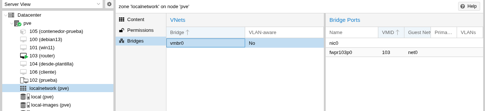
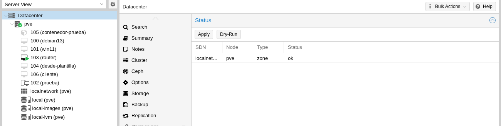

# Gestionando redes en Proxmox VE

Proxmox VE nos ofrece, de una manera muy sencilla, la gestión de las redes con las que va a trabajar. Esta gestión la podemos hacer en dos niveles:

* Podemos configurar **la configuración de red del servidor Proxmox VE** para determinar el tipo de conexión que tendrá el servidor con el exterior.
* Podemos configurar **la configuración de red que tendrán las máquinas virtuales y contenedores** que gestionemos en nuestro servidor Proxmox.

Antes de estudiar detenidamente cada una de estos niveles, vamos a introducir un concepto de redes con el que vamos a trabajar: un **puente o bridge/switch** es un dispositivo de interconexión de redes. En concreto, **Linux Bridge** es un software que tiene la misma funcionalidad que un bridge físico. 

## Dos formas de crear redes: la red del nodo y el SDN

En Proxmox VE 9 tenemos dos herramientas para crear las redes a las que se conectan las máquinas virtuales y los contenedores:

* **La configuración de red de cada nodo**, en la opción **System - Network** del nodo. Es la forma "clásica": en cada servidor creamos los bridges (**Linux Bridge**) y, si hace falta, otros elementos como la agregación de enlaces (**Linux Bond**) o las VLAN (**Linux VLAN**). Esta configuración se guarda en el fichero `/etc/network/interfaces` del servidor. **Es la que vamos a usar en este curso.**
* **SDN** (*Software-Defined Networking*, redes definidas por software), en la opción **Datacenter - SDN**. Viene instalado por defecto desde Proxmox VE 8.1. Nos permite definir las redes virtuales para todo el clúster desde un único sitio, y Proxmox se encarga de crearlas en cada nodo.

Los conceptos básicos del SDN son:

* **Zona** (*Zone*): un área de red separada de las demás. El tipo de zona indica cómo se separan las redes: **Simple** (una red aislada dentro de cada nodo; es la más sencilla y la única que veremos), **VLAN** y **QinQ** (usan etiquetas VLAN en la red física) y **VXLAN** y **EVPN** (redes que se extienden entre los nodos de un clúster por encima de la red IP).
* **VNet**: una red virtual que pertenece a una zona. En cada nodo, una VNet se convierte en un bridge al que conectamos las máquinas virtuales y los contenedores, igual que haríamos con un Linux Bridge.
* **Subred** (*Subnet*): el rango de direcciones IP de una VNet. Podemos indicar la puerta de enlace y activar **SNAT** para que las máquinas salgan al exterior a través del servidor Proxmox. En las zonas Simple también se puede activar un servidor **DHCP** automático, aunque necesita instalar el paquete `dnsmasq` en el nodo y todavía es una *technology preview* (una funcionalidad en pruebas).
* Los cambios en el SDN no se aplican al momento: quedan pendientes hasta que pulsamos el botón **Apply** en **Datacenter - SDN**.

El SDN tiene más opciones avanzadas (gestión de direcciones IP o IPAM, DNS, *Fabrics* para enrutar el tráfico entre los nodos de un clúster, ...) que no vamos a estudiar en este curso.

## ¿Qué es *localnetwork*?

En el árbol de recursos aparece un elemento llamado **localnetwork (pve)**. No es una red que hayamos creado nosotros: es la forma en que Proxmox VE muestra, dentro del SDN, los bridges locales del nodo, es decir, los que creamos en **System - Network**, como `vmbr0`. Proxmox los considera parte de una zona especial llamada `localnetwork`.

Si la seleccionamos tenemos tres opciones:

* **Content**: la lista de bridges del nodo.
* **Permissions**: los permisos para usar cada bridge. Un usuario necesita el privilegio **SDN.Use** sobre un bridge para poder conectar a él las tarjetas de red de sus máquinas.
* **Bridges**: los bridges y sus puertos: la interfaz física del servidor (`nic0`) y las tarjetas de red de las máquinas y contenedores que están conectados. En el ejemplo, el puerto `fwpr103p0` corresponde a la tarjeta `net0` de la máquina 103.

También aparece en la opción **Datacenter - SDN**, que muestra el estado de todas las zonas:

En resumen, **localnetwork** son los Linux Bridge de siempre vistos desde el SDN. Si creamos zonas en **Datacenter - SDN**, aparecerán en el árbol junto a ella.

## ¿Qué vamos a usar en este curso?

Con un único servidor, la forma más sencilla de crear redes es usar **Linux Bridge**, y es lo que vamos a usar en los siguientes apartados. Existen otras opciones para implementar un bridge por software, como **Open vSwitch** (que no viene instalado por defecto) o el **SDN**, del que veremos un ejemplo sencillo al final del apartado *Configuración de una red interna*.

---

Para seguir profundizando:

* [Network Configuration](https://pve.proxmox.com/wiki/Network_Configuration)
* [Software-Defined Network](https://pve.proxmox.com/pve-docs/chapter-pvesdn.html)
