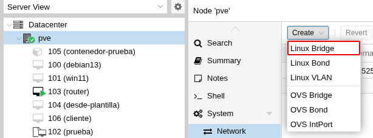
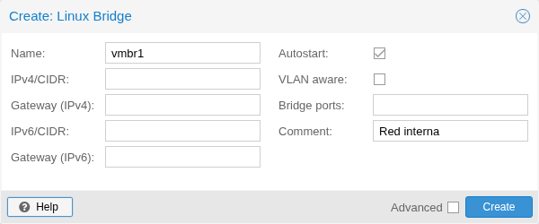
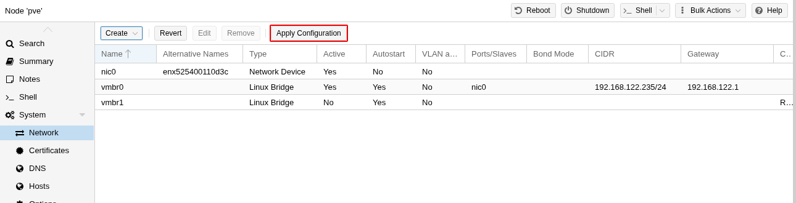
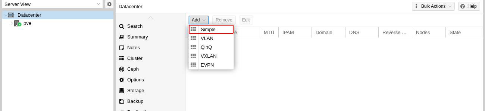
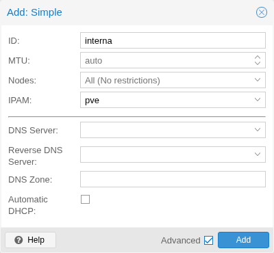
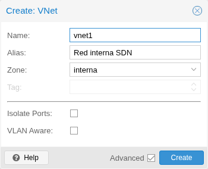
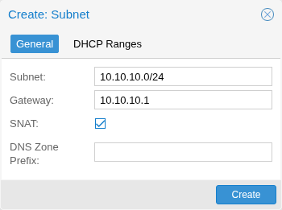
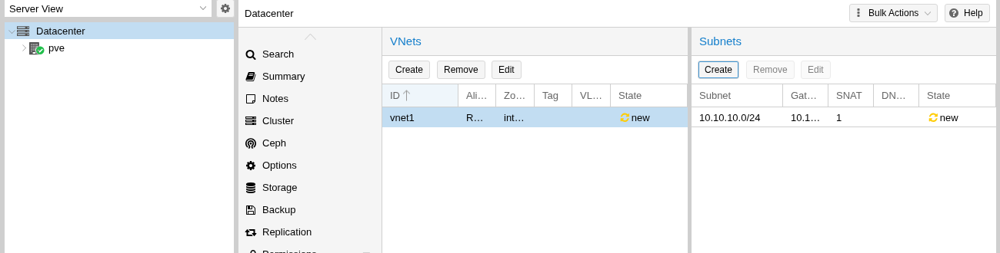
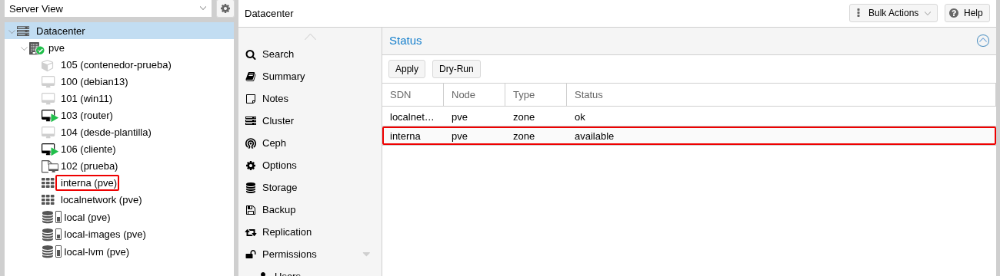

# Configuración de una red interna

Como hemos estudiado anteriormente, las máquinas virtuales y contenedores conectados al bridge **vmbr0** obtendrán direccionamiento automático, tendrán acceso al exterior y podremos acceder a ellos sin ningún problema.

Además, Proxmox VE nos permite crear nuevos **Linux Bridge** donde podremos conectar nuestras máquinas en una red privada. Algunos escenarios donde podríamos usar esta posibilidad podrían ser:

* Varias máquinas conectadas al exterior con una interfaz conectada a **vmbr0** y otra interfaz conectada a otro bridge. Estas máquinas tendrían una conexión entre ellas en una red privada.
* Un equipo que funcione como router/nat/cortafuegos que esté conectado al exterior por **vmbr0** y a otras redes internas donde tenemos diferentes máquinas.
* Un laboratorio de máquinas que no tengan conectividad al exterior y que estén conectadas a una red interna.

## Creación de un nuevo bridge

Para crear un nuevo bridge tenemos que elegir, en el nodo, la opción **System - Network - Create - Linux Bridge**:

En la creación del bridge tendremos que configurar los siguientes parámetros:

* El **nombre** del bridge: debe tener el formato de *vmbr* y un número. Se nos propone el siguiente libre, en nuestro caso **vmbr1**.
* Aunque no es necesario, podríamos asignarle una **ip al bridge** (**IPv4/CIDR**). En ese caso, el propio servidor Proxmox tendría una dirección en esa red y podría comunicarse con las máquinas conectadas a este bridge. En nuestro caso no la vamos a indicar porque no vamos a usar esta funcionalidad.
* El campo **Gateway** lo dejamos vacío: el servidor solo puede tener una puerta de enlace por defecto, y ya está configurada en **vmbr0**.
* El campo **Bridge ports** también lo dejamos vacío: si no conectamos ninguna interfaz física al bridge, tenemos una red interna, aislada del exterior.
* La opción **Autostart**, que viene marcada por defecto, hace que el bridge se levante tras un reinicio.
* Opcionalmente, podemos escribir un comentario (**Comment**) que nos ayude a recordar para qué sirve el bridge.

Una vez creado o modificado algún elemento de la red de Proxmox VE debemos aplicar los cambios con el botón **Apply Configuration** para que verdaderamente se produzca el cambio de configuración (con el botón **Revert** descartamos los cambios pendientes):

## Otra posibilidad: una red interna con SDN

Como vimos en la introducción, también podemos crear una red interna con el **SDN**. Vamos a crear una red `10.10.10.0/24` en la que el servidor Proxmox actúe de puerta de enlace y haga SNAT, de forma que las máquinas conectadas a ella tengan acceso al exterior.

En primer lugar, en **Datacenter - SDN - Zones** añadimos una zona de tipo **Simple**:

Le damos un identificador (como máximo 8 caracteres), por ejemplo `interna`. Si marcamos la casilla **Advanced** vemos el resto de opciones, entre ellas **Automatic DHCP**, que dejamos sin marcar:

A continuación, en **Datacenter - SDN - VNets** creamos una VNet en esa zona. Su nombre será el nombre del bridge que se creará en el nodo, en nuestro caso `vnet1`:

Seleccionamos la VNet y creamos una subred, indicando la red, la dirección del servidor en esa red (**Gateway**) y marcando **SNAT**:

Los nuevos elementos aparecen en estado **new**: todavía no se han aplicado.

Para aplicarlos vamos a **Datacenter - SDN** y pulsamos el botón **Apply**. La nueva zona aparece en el árbol de recursos junto a **localnetwork**:

A partir de este momento, al crear o modificar una tarjeta de red, podemos elegir el bridge **vnet1**. Las máquinas conectadas a él tendrán que configurarse con una IP de la red `10.10.10.0/24` y con la puerta de enlace `10.10.10.1`, y tendrán acceso al exterior gracias al SNAT que hace el servidor Proxmox.

* [Vídeo: Configuración de una red interna](https://youtu.be/LjUUSj4SjC8)
