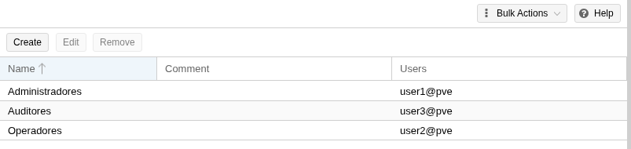
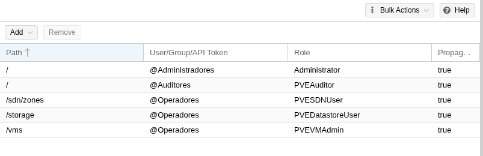
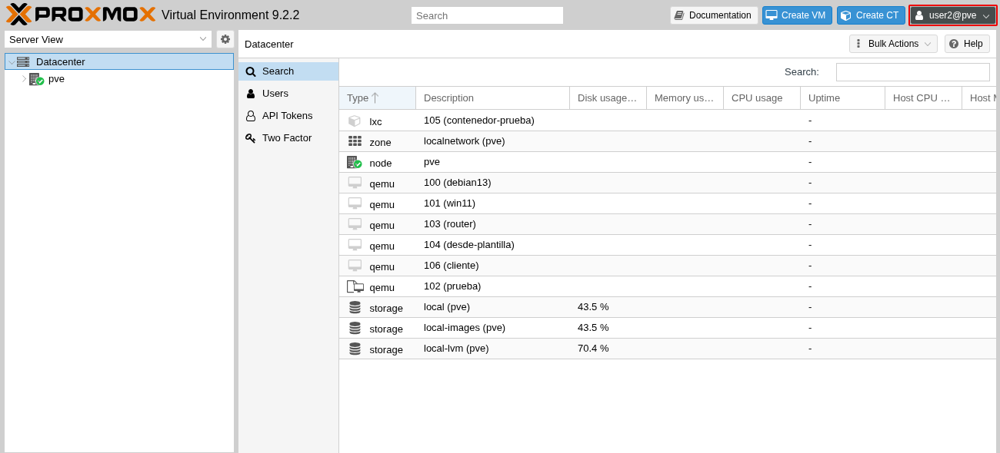
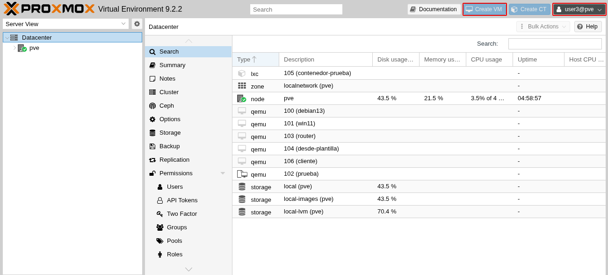

# Ejemplo 1: Especificar tipos de usuarios

En este primer ejemplo vamos a asignar diferentes roles a distintos grupos para que los distintos usuarios, según al grupo que pertenezcan, tengan unos permisos determinados. En este ejemplo no vamos a agrupar los recursos con **Pools de Recursos** por lo que todos los usuarios van a trabajar con los mismos recursos (fuentes de almacenamiento, máquinas virtuales y contenedores).

## Creación de grupos

Vamos a crear 3 grupos:

* **Administradores**: Los usuarios de este grupo están totalmente cualificados para gestionar ProxmoxVE, por lo que le vamos a asignar el rol `Administrator` para todos los objetos.
* **Operadores**: Los usuarios de este grupo sólo tienen la posibilidad de trabajar con fuentes de almacenamiento y gestionar máquinas virtuales. Pero no pueden modificar la configuración del sistema y del nodo de Proxmox VE. Así que le asignamos los roles `PVEDatastoreUser` (para las fuentes de almacenamiento) y `PVEVMAdmin` (para las máquinas virtuales). Además, para que puedan conectar las máquinas a las redes, les asignamos el rol `PVESDNUser` sobre la ruta `/sdn/zones`.
* **Auditores**: Los usuarios de este grupo sólo tienen acceso a ver las máquinas virtuales. Se le asigna el rol de  `PVEAuditor`.

Creamos tres usuarios (`user1`, `user2` y `user3`), uno en cada grupo:

Y asignamos los permisos: a los administradores el rol `Administrator` y a los auditores el rol `PVEAuditor`, los dos sobre la ruta `/` (que incluye todos los objetos), y a los operadores los roles anteriores sobre las rutas `/storage`, `/vms` y `/sdn/zones`:

## Prueba de funcionamiento

1. Puedes comprobar que al acceder con el `user1` (administrador) tienes todas las funcionalidades y posibilidades que tiene el usuario administrador `root`.
2. Al acceder con el `user2` (operador), comprobamos que, aunque puede trabajar con fuentes de almacenamiento y máquinas virtuales, no puede acceder a la mayoría de las características del sistema Proxmox VE. Por ejemplo, a nivel de **Datacenter** sólo aparecen las opciones de buscar y las relacionadas con los usuarios (no puede ver el **Summary** ni cambiar la configuración):
    
    

3. Finalmente, si accedemos con el `user3` (auditor), observamos que sólo tenemos la posibilidad de ver información, por ejemplo los botones de crear máquinas virtuales o contenedores aparecen deshabilitados:

    

* [Vídeo: Ejemplo 1: Especificar tipos de usuarios](https://youtu.be/WKBUaICS8B8)
