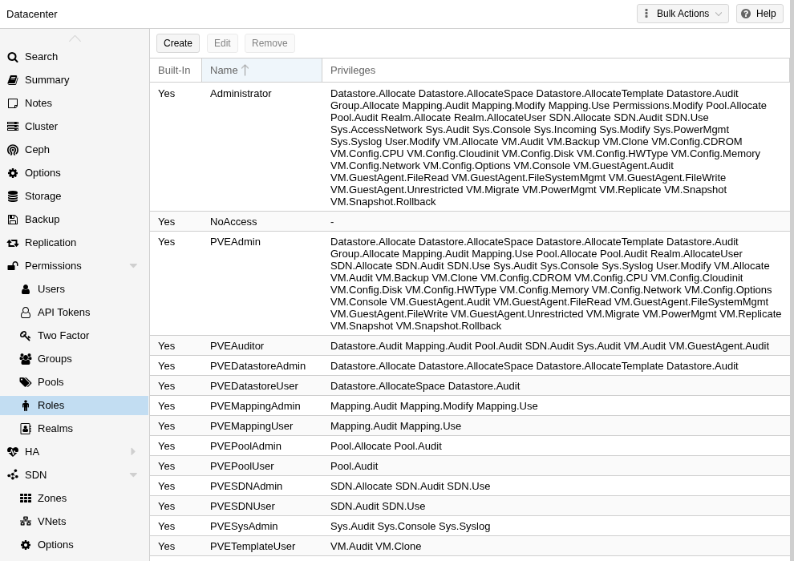
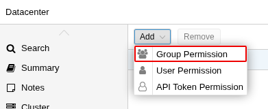
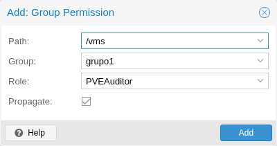
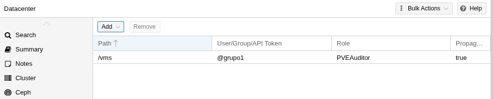
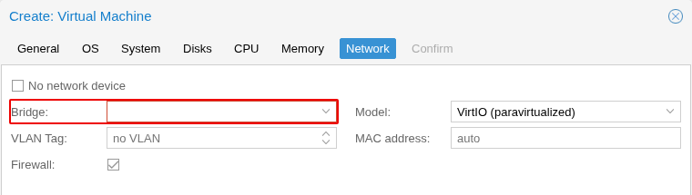
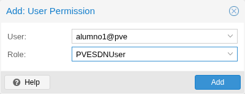

# Gestión de Permisos

Un **privilegio** es el derecho a realizar una acción específica. Para simplificar la gestión, las listas de privilegios se agrupan en **roles**, que luego pueden utilizarse en la **tabla de permisos**. Tenga en cuenta que los privilegios no pueden asignarse directamente a los usuarios o grupos sin formar parte de un rol.

## Privilegios

* Privilegios relacionados con el nodo/sistema:

    * `Permissions.Modify`: modificar los permisos de acceso.
    * `Sys.PowerMgmt`: gestión de la energía del nodo (arranque, parada, reinicio, apagado, ...).
    * `Sys.Console`: acceso a la consola del nodo.
    * `Sys.Syslog`: ver el syslog.
    * `Sys.Audit`: ver el estado/configuración del nodo, la configuración del clúster.
    * `Sys.Modify`: crear/modificar/eliminar los parámetros de red del nodo.
    * `Sys.Incoming`: permitir la recepción de datos desde otros clústeres (experimental).
    * `Group.Allocate`: crear/modificar/eliminar grupos.
    * `Pool.Allocate`: crear/modificar/eliminar un pool de recursos.
    * `Pool.Audit`: ver un pool de recursos.
    * `Realm.Allocate`: crear/modificar/eliminar fuentes de autentificación.
    * `Realm.AllocateUser`: asignar un usuario a una fuente de autentificación.
    * `User.Modify`: crear/modificar/eliminar el acceso y los detalles del usuario.

* Privilegios relacionados con las redes (SDN) y los mapeos de recursos:

    * `SDN.Allocate`: gestionar la configuración del SDN.
    * `SDN.Audit`: ver la configuración del SDN.
    * `SDN.Use`: usar las redes virtuales (VNets) y los bridges locales del nodo, es decir, poder conectar a ellos las tarjetas de red de las máquinas virtuales y contenedores.
    * `Mapping.Audit`: ver los mapeos de recursos (dispositivos del servidor que se pueden asignar a las máquinas).
    * `Mapping.Modify`: crear/modificar/eliminar mapeos de recursos.
    * `Mapping.Use`: usar un mapeo de recursos en una máquina virtual.

* Privilegios relacionados con la máquina virtual o contenedor:

    * `VM.Allocate`: crear/eliminar máquinas virtuales/contenedores en un servidor.
    * `VM.Migrate`: migrar las máquinas virtuales/contenedores a un servidor alternativo en el clúster.
    * `VM.PowerMgmt`: gestión de la energía (arranque, parada, reinicio, apagado, ...) de una máquina virtual.
    * `VM.Console`: acceso a la consola de las máquinas virtuales/contenedores.
    * `VM.Backup`: copia de seguridad/restauración de máquinas virtuales/contenedores.
    * `VM.Audit`: ver la configuración de las máquinas virtuales/contenedores.
    * `VM.Clone`: clonar/copiar máquinas virtuales/contenedores.
    * `VM.Config.Disk`: añadir/modificar/eliminar discos.
    * `VM.Config.CDROM`: expulsar/cambiar CD-ROM.
    * `VM.Config.CPU`: modificar la configuración de la CPU.
    * `VM.Config.Memory`: modificar la configuración de la memoria.
    * `VM.Config.Network`: añadir/modificar/eliminar dispositivos de red.
    * `VM.Config.HWType`: modificar los tipos de hardware emulados.
    * `VM.Config.Options`: modificar cualquier otra configuración de las máquinas virtuales/contenedores.
    * `VM.Config.Cloudinit`: modificar los parámetros de Cloud-Init.
    * `VM.Snapshot`: crear/borrar instantáneas de las máquinas virtuales/contenedores.
    * `VM.Snapshot.Rollback`: volver a una instantánea de una máquina virtual.
    * `VM.Replicate`: configurar y ejecutar la replicación de una máquina virtual.
    * `VM.GuestAgent.Audit`: ejecutar comandos informativos del agente QEMU.
    * `VM.GuestAgent.FileRead`: leer ficheros de la máquina virtual mediante el agente QEMU.
    * `VM.GuestAgent.FileWrite`: escribir ficheros en la máquina virtual mediante el agente QEMU.
    * `VM.GuestAgent.FileSystemMgmt`: congelar/descongelar/optimizar (*trim*) los sistemas de ficheros mediante el agente QEMU.
    * `VM.GuestAgent.Unrestricted`: ejecutar cualquier comando del agente QEMU.

* Privilegios relacionados con el almacenamiento:

    * `Datastore.Allocate`: crear/modificar/eliminar una fuente de almacenamiento y eliminar volúmenes.
    * `Datastore.AllocateSpace`: asignar espacio en una fuente de almacenamiento.
    * `Datastore.AllocateTemplate`: asignar/cargar plantillas e imágenes ISO.
    * `Datastore.Audit`: ver/examinar una fuente de almacenamiento.

## Roles

Como se ha indicado los privilegios no se asignan directamente. Los **roles** son conjuntos de privilegios que son los que se van a asignar para otorgar los permisos. Los roles predefinidos que tenemos son los siguientes:

* `Administrator`: tiene todos los privilegios.
* `NoAccess`: no tiene privilegios (se utiliza para prohibir el acceso).
* `PVEAdmin`: puede realizar la mayoría de las tareas, pero no tiene derechos para modificar la configuración del sistema.
* `PVEAuditor`: sólo tiene acceso de lectura.
* `PVEDatastoreAdmin`: crea y asigna el espacio y las plantillas de las copias de seguridad.
* `PVEDatastoreUser`: asigna el espacio de copia de seguridad y ve el almacenamiento.
* `PVEMappingAdmin`: gestionar los mapeos de recursos.
* `PVEMappingUser`: ver y utilizar los mapeos de recursos.
* `PVEPoolAdmin`: asigna Pools de Recursos.
* `PVEPoolUser`: ver o utilizar Pools de Recursos.
* `PVESDNAdmin`: gestionar la configuración del SDN.
* `PVESDNUser`: usar las redes virtuales y los bridges (poder conectar máquinas a ellos).
* `PVESysAdmin`: auditoría, consola del sistema y registros del sistema.
* `PVETemplateUser`: ver y clonar plantillas de contenedores.
* `PVEUserAdmin`: gestionar usuarios.
* `PVEVMAdmin`: administrar completamente las máquinas virtuales/contenedores.
* `PVEVMUser`: ver, hacer copias de seguridad, configurar el CD-ROM, acceder a la consola, gestionar la energía de las máquinas virtuales/contenedores.

Podemos crear nuevos roles para asignar nuevos perfiles de usuarios.

## Asignación de permisos

Los permisos (**roles**) se asignan a un **usuario o grupo** y a un **objeto** (máquina virtual/contenedor, fuente de almacenamiento, pool de recursos, ...). Utilizamos rutas similares a las del sistema de archivos para indicar los objetos. Estas rutas forman un árbol y los permisos de niveles superiores (rutas más cortas) pueden propagarse opcionalmente hacia abajo dentro de esta jerarquía.

Ejemplo de rutas:

* `/vms`: Indica todas las máquinas virtuales y contenedores.
* `/vms/{vmid}`: Indica una máquina virtual o contenedor con un id determinado.
* `/storage/{storeid}`: Indica una fuente de almacenamiento con un id determinado.
* `/pool/{poolname}`: Indica un pool de recursos con un nombre determinado.
* `/sdn/zones/localnetwork`: Indica los bridges del nodo (`vmbr0`, `vmbr1`, ...), que vimos en el módulo anterior dentro de la zona `localnetwork`.
* `/sdn/zones/localnetwork/{bridge}`: Indica un bridge concreto, por ejemplo `/sdn/zones/localnetwork/vmbr1`.
* `/sdn/zones/{zona}/{vnet}`: Indica una red virtual (VNet) de una zona del SDN.
* ...

Como hemos indicado un permiso está formado por una terna: Usuario/Grupo, Objeto/Ruta y Rol. Por ejemplo, vamos a asignar a los usuarios del *grupo1* permiso de auditor (`PVEAuditor`) para todas las máquinas virtuales o contenedores.

Lo primero, escogemos el tipo de permiso, en este caso un permiso a un grupo:

A continuación, indicamos el objeto/ruta, el grupo y el rol:

Y podemos ir viendo los permisos que estamos asignando:

## Permisos y redes

Las redes también se controlan con permisos. El privilegio **SDN.Use** es el que permite a un usuario conectar una máquina virtual o un contenedor a una red, tanto a un Linux Bridge del nodo (como `vmbr0` o el `vmbr1` que creamos en el módulo anterior) como a una VNet del SDN. Está incluido en los roles `PVESDNUser`, `PVESDNAdmin`, `PVEAdmin` y `Administrator`. El permiso se asigna sobre una ruta, que puede ser:

* `/sdn/zones/localnetwork`: todos los bridges del nodo.
* `/sdn/zones/localnetwork/vmbr1`: un bridge concreto. Así podemos conseguir que un usuario sólo pueda usar un bridge determinado.
* `/sdn/zones/{zona}/{vnet}`: una VNet de una zona del SDN.

Si un usuario no tiene el permiso **SDN.Use** sobre ningún bridge, no podrá conectar sus máquinas a ninguna red: al crear una máquina virtual, el campo **Bridge** de la pestaña **Network** aparece vacío y no se puede continuar con el asistente (la única opción sería marcar *No network device*).

Por lo tanto, además de los permisos sobre las máquinas virtuales y las fuentes de almacenamiento, tendremos que dar a nuestros usuarios el rol `PVESDNUser` sobre las redes que queremos que utilicen. Podemos hacerlo desde **Datacenter - Permissions** o, de forma más sencilla, seleccionando **localnetwork** en el árbol de recursos y eligiendo la opción **Permissions - Add - User Permission** (o **Group Permission**):

De esta forma podemos asegurar que un alumno sólo utilice las redes que ha creado el administrador. Recuerda que los Linux Bridge no se pueden agrupar en un pool de recursos, por lo que los permisos sobre las redes se asignan siempre con estas rutas. Además, para crear nuevos Linux Bridge hace falta el privilegio `Sys.Modify`, que sólo tiene el rol `Administrator`.

* [Vídeo: Gestión de Permisos](https://youtu.be/hodVVKQ6Y_4)
