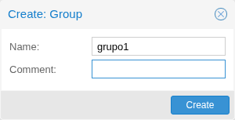
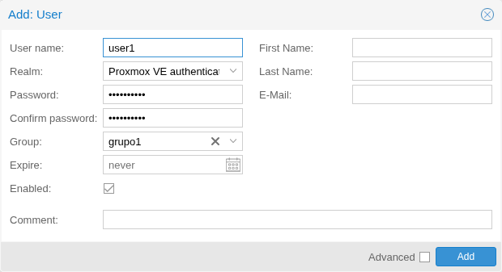

# Gestión de Usuarios y Grupos

## Creación de Grupos

Para crear un grupo solamente es necesario indicar su nombre y opcionalmente un comentario:

Los grupos se pueden editar (para cambiar el comentario) y eliminar.

## Creación y gestión de Usuarios

Al crear un usuario con el botón **Add** tenemos que escoger la fuente de autentificación (**Realm**; en este ejemplo vamos a escoger *Proxmox VE Authentication Server*):

Además del nombre de usuario y la contraseña, podremos indicar la siguiente información:

* Nombre
* Apellido
* Dirección de correo electrónico
* Grupos a los que pertenece
* Opcionalmente, una fecha de caducidad (**Expire**)
* Un comentario o nota sobre este usuario
* Si este usuario está habilitado o deshabilitado (**Enabled**)
* ...

Los usuarios se pueden modificar (**Edit**), borrar (**Remove**), podemos cambiar su contraseña (**Password**), ver los permisos que tienen (**Permissions**), ...

* [Vídeo: Gestión de Usuarios y Grupos](https://youtu.be/_xIAOjzFjcs)
